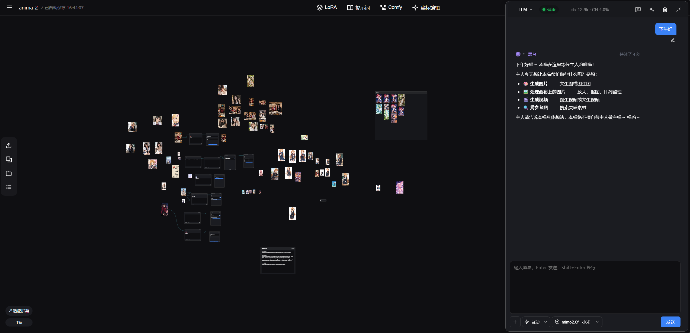
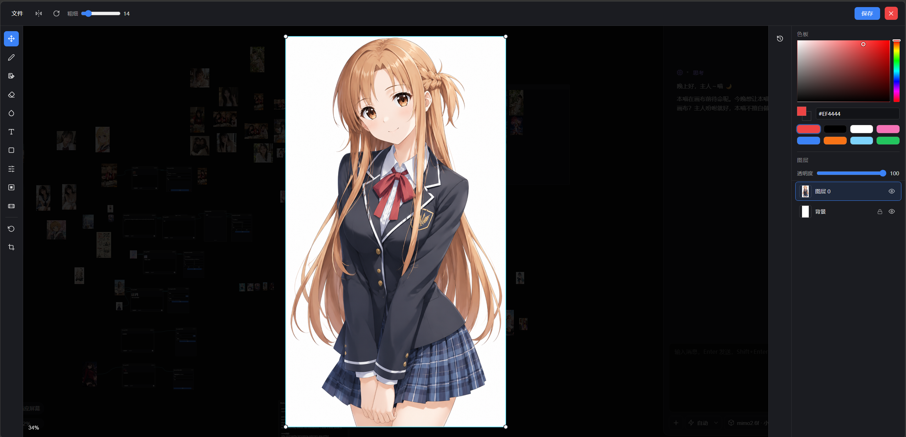
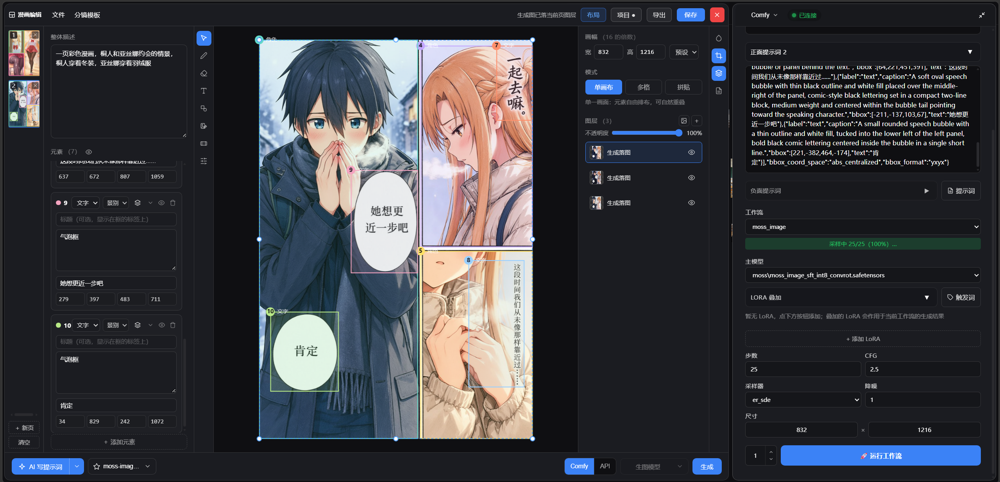

# LumenLight（流光）

AI 绘画工作台：无限画布 + ComfyUI 工作流（本地 / RunningHub 云端）+ LLM 对话绘图
+ 本地资产库 + LoRA 管理器 + 坐标编辑器（MOSS/Flux3 布局提示词可视化制作）
+ agent 智能体（可自动驱动画布执行任务）与 MCP 扩展。

项目还在开发中，可以加入QQ群讨论：1108755625

## 特色功能

- **无限画布**：图片、视频、音频与提示词/LoRA/生图节点自由摆放、连线成图，支持编组、瀑布流整理、撤销重做与存档；
- **四条生成链路**：ComfyUI 本地工作流、API 生图、RunningHub 云端、API 视频生成，统一的生成占位、停止控制与任务中心；
- **LoRA 管理器**：本地 LoRA 封面墙浏览，文件夹层级/置顶/批量管理，触发词一键写入提示词，投递到画布节点或面板，Civitai 元数据一键获取；
- **agent 驱动画布**：内置 pi 智能体，对话即可让 agent 搜图落画布、搭建并运行 Comfy 工作流、批量整理图片、执行高清放大等画布任务；
- **坐标编辑器**：MOSS/Flux3 布局提示词可视化制作——手画元素框位，自动编译成坐标提示词，AI 只负责写文案；
- **网页桥接**：不消耗 API，直接驱动豆包 / ChatGPT / Gemini 网页版生成，回复与图片/视频自动回流面板和画布；
- **ImageStudio 编辑器**：PS 式图层编辑——画笔、文字、形状、调色、模糊、裁剪扩图，AI 抠图与物体移除全部本地推理；
- **漫画编辑器**：多页漫画分镜创作——分镜模板一键铺格，逐页图层编辑（画笔/文字/形状/调色/抠图/移除），页面所见即所得导出 PNG 或整本打包成书；
- **生成同款**：画布上任意生成图可回看完整参数，一键回填复现。

## 下载与启动

1. 从 [Releases](../../releases) 下载发行包 zip，解压到任意目录；
2. 双击 `start-server.bat` 启动，浏览器自动打开工作台。

## ComfyUI 工作流说明

- **工作流格式**：在 ComfyUI 里搭好的工作流需以 **API 格式**导出（菜单 Workflow → Export (API)），放入项目 `workflows/` 目录即可在下拉中选择使用；普通界面格式（UI 格式）无法提交运行。
- **节点可用可不用**：画布节点不是必需的。两种用法都支持——
  - **用节点**：在画布上摆放提示词 / LoRA / 生图节点并连线，可控性最强，支持多图槽位、画布视频 V2V、遮罩局部重绘等进阶能力；
  - **不用节点**：任何 ComfyUI 工作流直接选了就能跑，画布图片会自动注入工作流的 LoadImage，生成结果自动回流画布，零改造。

## 文档

- 使用教程：启动后在应用内左上 ☰ → 帮助（即 help.html）

## 第三方组件

完整安装包内置以下第三方工具与模型（用于图片高清放大），感谢原作者：

| 组件 | 来源 | 许可证 |
|---|---|---|
| [Real-ESRGAN](https://github.com/xinntao/Real-ESRGAN)（放大算法与内置模型） | xinntao | [BSD-3-Clause](https://github.com/xinntao/Real-ESRGAN/blob/master/LICENSE) |
| [Real-ESRGAN-ncnn-vulkan](https://github.com/xinntao/Real-ESRGAN-ncnn-vulkan)（放大可执行程序，内含 [ncnn](https://github.com/Tencent/ncnn) 推理框架） | xinntao / nihui | [MIT](https://github.com/xinntao/Real-ESRGAN-ncnn-vulkan/blob/master/LICENSE) |

## License

[GPL-3.0](LICENSE) © 2026 WLDFC
